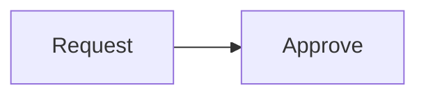

# User Guide

**English** · [日本語](運用手順.md)

How to produce formal PDF and Word (.docx) documents from Markdown with this extension (Markdown Formal PDF / Word).
Written for first-time users.

---

## 0. Key points

- **Your Markdown file is never modified.** Conversion only reads it.
- **The PDF is the authoritative copy; Word is an editable draft.** PDF and Word are produced by different engines, so they look slightly different. Each section lists the differences in a table.
- **Protection has limits.** The edit restriction only discourages accidental edits, and a digital signature *detects* tampering. Neither *prevents* it.
- **If you cannot control which viewer people use, the only check that always works is comparing the SHA-256 fingerprint against your register.**

### Find what you need

| I want to… | Read |
|---|---|
| Install the extension | [1. Setup](#1-setup) |
| Add a cover page, a document number or a confidentiality stamp | [2-1. Cover page information](#2-1-cover-page-information) |
| Know where pages break, or get rid of a blank page | [2-2. How page breaks are decided](#2-2-how-page-breaks-are-decided) |
| Change the line spacing | [2-3. Line spacing](#2-3-line-spacing) |
| Understand column widths and tables that span pages | [2-4. Tables](#2-4-tables) |
| Change the size of Mermaid diagrams | [2-5. Diagrams (Mermaid)](#2-5-diagrams-mermaid) |
| Insert draw.io diagrams or photos | [2-6. Images](#2-6-images) |
| Keep a hand-written table of contents out of the PDF/Word | [2-7. Table of contents](#2-7-table-of-contents) |
| Convert | [3. Convert](#3-convert) |
| Restrict editing or sign the PDF | [4. Protection](#4-protection) |
| Check that a file has not been tampered with | [5. Tamper detection](#5-tamper-detection-most-important) |
| Fix a problem | [7. Troubleshooting](#7-troubleshooting) |

---

## 1. Setup

### 1-1. Prerequisites

Producing a PDF requires either Google Chrome or Microsoft Edge.
They are also used to draw Mermaid diagrams and the confidentiality stamp, so you need one even if you only produce Word files.

The browser is found automatically in its usual location. Only if it is not found,
set `markdownFormal.browser.executablePath` to the browser's executable.

| OS | Usual location |
|---|---|
| macOS | `/Applications/Google Chrome.app/Contents/MacOS/Google Chrome` |
| Windows | `C:\Program Files\Google\Chrome\Application\chrome.exe` |
| Linux | `/usr/bin/google-chrome` |

---

### 1-2. Installing the extension

Install the VSIX (extension file) you received from a terminal.
Change the version in the file name (`0.3.7`) to match your file.

```bash
code --install-extension markdown-formal-pdf-0.3.7.vsix --force
```

Check that it is installed.

```bash
code --list-extensions --show-versions | grep markdown-formal-pdf
```

→ Success if you see the name with its version, such as `kazunito.markdown-formal-pdf@0.3.7`.

Finally, run `Developer: Reload Window` from the VS Code Command Palette (`Ctrl/Cmd + Shift + P`).
The old version keeps running until you do.

> **Note**: An extension distributed as a VSIX does not update itself. Reinstall it the same way whenever you receive a new version.

---

## 2. Writing documents

### 2-1. Cover page information

At the top of the Markdown, write the cover information between `---` lines (called front matter). The cover page is generated from it.

```markdown
---
title: System Operations Manual
subtitle: Version 1.0
author: Infrastructure Operations Team
date: 2026-08-08
docno: DOC-INF-2026-0142
classification: Confidential
---
```

| Field | Position on the cover | Optional |
|---|---|---|
| `docno` | Top left (document control number) | Yes |
| `classification` | Top right (red stamp) | Yes |
| `title` | Center | Yes |
| `subtitle` | Center | Yes |
| `author` / `date` | Lower center | Yes |

- If none of `title`, `docno` or `classification` is given, no cover page is made and page 1 is the table of contents (PDF and Word).
- The cover and the table of contents have no page numbers; the first body page is page 1.

---

### 2-2. How page breaks are decided

Page breaks are decided automatically. You do not need to write any page-break markers in the Markdown.

| Rule | PDF | Word |
|---|---|---|
| The cover and the table of contents each take a whole page | Yes | Yes |
| A page break comes before `#` and `##` (heading levels 1 and 2). Change it with `heading.pageBreakLevel` (`1` = only `#`, `0` = never) | Yes | Yes |
| No page break before the first heading of the body (so no blank page) | Yes | Yes |
| A heading is never left alone at the bottom of a page; it moves with the content that follows | Yes | Yes |
| A Mermaid diagram right after a heading stays on the same page as the heading | Yes | Yes |
| Diagrams and images are never cut; if they do not fit, they move to the next page | Yes | Yes |
| Table rows are never cut. The whole table is not moved; it is split at the page boundary ([2-4](#2-4-tables)) | Yes | Yes |
| Code blocks and quotes are split at the page boundary | Yes | Yes |
| When splitting, at least 2 lines stay on each side (no single stranded line) | Yes | Yes |
| A chapter's introduction and its first small table (6 rows or fewer) stay on the same page | Yes | No |
| No blank page after a table that ends right before a chapter | — | Yes |

- "—" for PDF means the problem does not occur there, so no measure is needed.
- If a heading and its diagram are too tall for one page, the diagram shrinks automatically ([2-5](#2-5-diagrams-mermaid)).

---

### 2-3. Line spacing

Body line spacing is set by `font.lineHeight` (a multiple of the font size, default `1.75`).
The font size is `font.size` (default `10.5pt`).

| Part | Font size | Line height |
|---|---|---|
| Body, lists, quotes | `font.size` | font size × `font.lineHeight` |
| Headings | Fixed size per heading level | font size × 1.35 |
| Tables, code blocks | 9pt | 9pt × `font.lineHeight` |

PDF and Word use the same line heights. Only lines that contain an image let Word choose the height automatically, so the image is not cut.

---

### 2-4. Tables

Use ordinary Markdown tables. No column widths are needed.

| Rule | PDF | Word |
|---|---|---|
| Column widths follow the contents; columns with long text get more room | Yes | Yes |
| A column whose cells (header included) are all 8 characters or fewer (numbers, chapters, regions…) never wraps | Yes | Yes |
| Long URLs and identifiers wrap only when needed | Yes | Yes |
| Rows are never cut; a row that does not fit moves to the next page | Yes | Yes |
| The header row is repeated on the continuation page of a table | No | Yes |

- The 8-character rule keeps short labels such as "No." or "Ch. 10" from being broken across lines. A column that contains even one long cell still wraps, so it does not squeeze the other columns.
- A table with too many columns to fit can be wrapped in `<div class="fit">` and `</div>` to shrink it to 60% (PDF only).

```markdown
<div class="fit">

| Col 1 | Col 2 | Col 3 | Col 4 | Col 5 | Col 6 |
|---|---|---|---|---|---|
| … | … | … | … | … | … |

</div>
```

→ Leave the line after `<div class="fit">` and the line before `</div>` empty. Otherwise the table is not recognized.

---

### 2-5. Diagrams (Mermaid)

```` ```mermaid ```` code blocks are drawn as diagrams. The PDF gets a vector image (SVG) that stays sharp when zoomed; Word gets a picture (PNG).

````markdown

````

The size of a diagram is decided in this order:

1. The width grows to the text width (`mermaid.maxWidth` sets the limit as a percentage of the text width, default `100`)
2. To keep diagrams with few shapes from becoming huge, growth stops where the diagram text would exceed the table text (9pt)
3. If the height exceeds `mermaid.maxHeightMm` (default `120` mm), the diagram shrinks to fit; if it cannot fit on one page, it shrinks to the page height

PDF and Word use the same sizes.

- If a tall diagram becomes too small, use a larger paper (`page.format` = `A3`) or landscape (`page.orientation` = `landscape`). Both apply to PDF and Word.
- If the diagram has a syntax error, it is kept as a code block and the reason appears in the notification after conversion.
- To keep code blocks as code, turn off `mermaid.enabled`.
- Change the colors with `mermaid.theme`. The default `neutral` is safest for black-and-white printing.

---

### 2-6. Images

Insert images with the Markdown syntax ``. Write the location relative to the folder that contains the Markdown file.

```markdown

```

→ Inserts `01-overview.drawio.png` from the `diagrams` folder next to the Markdown file. File names with spaces or non-ASCII characters work.

Supported formats differ between PDF and Word.

| Format (extension) | PDF | Word |
|---|---|---|
| PNG (`.png`) | Yes | Yes |
| JPEG (`.jpg` / `.jpeg`) | Yes | Yes |
| GIF (`.gif`) | Yes | Yes (only the first frame of an animated GIF) |
| SVG (`.svg`) | Yes | No |
| WebP, BMP, TIFF, HEIC, etc. | No | No |
| Images on the web (`https://…`) | No | No |

- **Export draw.io diagrams as PNG.** SVG exports do not appear in Word.
- Images are never enlarged beyond their own size; they shrink to the text width and to a height that fits on one page. An image alone on its line is centered.
- The format is detected from the extension. If the extension does not match the contents (for example a JPEG named `.png`), the size may be wrong in Word.
- If an image cannot be inserted, its description is shown as text, and the notification after conversion gives the file name and the reason.

---

### 2-7. Table of contents

The table of contents is generated from the headings. How deep it goes is set by `toc.depth` (default `3` = down to `###`).

| Rule | PDF | Word |
|---|---|---|
| Lists the headings with a link to each | Yes | Yes |
| Shows page numbers | Yes (automatic) | Update by hand (below) |

**Page numbers in Word**: Word files are produced with the page numbers of the table of contents left empty.
In Word, select everything with `Ctrl + A` (`Cmd + A` on a Mac) and press `F9` to fill them in.
Save the file and the page numbers stay the next time you open it. Word does not ask to update fields when it opens the file.

**Title**: The default title is `Contents`. Change it with `toc.title` if your document is in another language.

**Keeping a hand-written table of contents out**: If you wrote a table of contents in the body for reading on GitHub or in the VS Code preview,
surround it with `<!-- toc -->` and `<!-- /toc -->`. The surrounded part does not appear in the PDF or Word, so the table of contents is not duplicated.
The markers are invisible in the rendered Markdown.

```markdown
<!-- toc -->
## Contents
1. [Introduction](#chapter-1-introduction)
2. [Procedure](#chapter-2-procedure)
<!-- /toc -->
```

- `<!-- tocstop -->` also works as the closing marker. It is what VS Code TOC extensions (such as Markdown All in One) insert.
- Letter case and spaces around the markers do not matter. Put each marker on a line by itself.
- If the closing marker is missing, nothing is removed (so the body is never deleted by mistake).
- Markers inside code blocks (```…```) are treated as examples and ignored.

---

## 3. Convert

With the Markdown file open, convert in one of these ways:

- The button at the top right of the editor (converts to both PDF and Word)
- Right-click in the editor, on the tab or in the Explorer → `Convert with Markdown Formal`
- Run one of these commands from the Command Palette (`Ctrl/Cmd + Shift + P`)

| Command | Output |
|---|---|
| `Markdown Formal: Convert to PDF` | `.pdf` and `.pdf.sha256` |
| `Markdown Formal: Convert to Word (docx)` | `.docx` and `.docx.sha256` |
| `Markdown Formal: Convert to both PDF and Word` | All of the above |

- Files are written to the folder of the Markdown file (change it with `outputDirectory`).
- `.sha256` is the file fingerprint used for tamper checks ([5](#5-tamper-detection-most-important)).

> **Command names follow the VS Code display language.** The names above are for English. In Japanese they are `PDF に変換` and so on.

> **Text printed in the document does not follow the display language.** Set the table of contents title (`toc.title`, default `Contents`) and
> the signing reason (`signing.reason`, default `Approved as an official document`) yourself when the document is not in English.

---

## 4. Protection

### 4-1. Choose a mode

Choose with `markdownFormal.protection.mode`. **The edit restriction and the digital signature cannot be combined.**

| Value | Meaning | When to use |
|---|---|---|
| `none` | No protection | Drafts, before review |
| `restrict` | Edit restriction (permissions password) | **Default while you have no certificate** |
| `sign` | Digital signature | When you have a certificate and can specify the viewer |

---

### 4-2. Using the edit restriction

Run `Markdown Formal: Store the owner password (SecretStorage)` from the Command Palette and enter a password.
It is stored in VS Code's secure storage (SecretStorage), never in `settings.json`.

Check that the restriction was applied. Replace `manual.pdf` with the name of your PDF.

```bash
pdfinfo manual.pdf | grep -i encrypted
```

→ If the line contains `change:no`, editing is restricted.

> **Limit**: The edit restriction is a request that relies on the viewer to honor it.
> Some viewers ignore it, so it prevents accidental edits but not tampering.

---

### 4-3. Using a digital signature

**You need a certificate first.**

1. Have your internal certificate authority (CA) issue a document-signing certificate (`.p12` / `.pfx`)
2. Store it in a safe place **outside the repository** (for example `~/.certs/doc-signing.p12`)
3. Set `markdownFormal.signing.certificatePath` to its full path
4. Run `Markdown Formal: Store the certificate passphrase (SecretStorage)` from the Command Palette
5. Set `markdownFormal.protection.mode` to `sign`

Check the signature. Replace `manual.pdf` with the name of your PDF.

```bash
pdfsig manual.pdf
```

→ `Signature is Valid.` means the file has not changed since it was signed.

> **Limit**: A signature *detects* tampering rather than preventing it. The file can still be edited;
> editing invalidates the signature, which is how tampering is noticed.

---

## 5. Tamper detection (most important)

### 5-1. Differences between viewers

**The viewer is what checks the signature**, so some viewers will not notice tampering.

| Viewer | Signature check |
|---|---|
| Adobe Acrobat Reader | Checks automatically and shows a banner (**recommended**) |
| Microsoft Edge | Supported but **off by default**; enable it with the `PDFSecureMode` policy or similar |
| Google Chrome | **Cannot check** |
| Command line | `pdfsig` can check |

Chrome also has a known problem: **printing a signed PDF with "Save as PDF" silently removes the signature.**
Do not re-save signed documents with Chrome.

---

### 5-2. When you cannot specify the viewer

**Make the SHA-256 fingerprint register the core of your process.** It does not depend on any viewer.
If a file changes by even one character, its fingerprint becomes completely different.

**When issuing**: Copy the contents of the `.sha256` file, created together with the output, into your document register.

```bash
cat manual.pdf.sha256
```

→ Shows the fingerprint and the file name, such as `efe17a83…3ba7a  manual.pdf`. Copy this line into the register.

**When receiving**: The recipient checks the fingerprint of their copy (macOS / Linux).

```bash
shasum -a 256 -c manual.pdf.sha256
```

→ `manual.pdf: OK` means the file has not been tampered with.

To compare with the register by eye, show only the fingerprint.

```bash
shasum -a 256 manual.pdf
```

→ If the value matches the register, the file has not been tampered with.

On Windows, show the fingerprint with PowerShell.

```powershell
Get-FileHash -Algorithm SHA256 .\manual.pdf
```

→ Compare the `Hash` value with the register (letter case does not matter).

The **document control number** on the cover (`docno`) is the key that links the document to the register.

---

### 5-3. Checking from the extension

Run `Markdown Formal: Verify a PDF (fingerprint / protection state)` from the Command Palette and choose the PDF.
The output panel shows the page count, whether editing is restricted, whether it is signed, and the SHA-256 value.

---

## 6. Migration plan

| Stage | Protection | Detection |
|---|---|---|
| Now (no certificate) | Edit restriction against accidental edits | SHA-256 register |
| After obtaining a certificate | Switch to digital signature (cannot be combined with the edit restriction) | Signature check + SHA-256 |

Once you have a certificate, changing `protection.mode` to `sign` is all it takes.

---

## 7. Troubleshooting

| Symptom | What to do | Details |
|---|---|---|
| `Neither Chrome nor Edge was found.` | Install one of them, or set `browser.executablePath` | [1-1](#1-1-prerequisites) |
| A fix does not seem to take effect | Run `Developer: Reload Window`, then convert again | [1-2](#1-2-installing-the-extension) |
| No page numbers in the table of contents (Word) | In Word, press `Ctrl + A` → `F9`, then save | [2-7](#2-7-table-of-contents) |
| Word asks to update the table of contents every time, even after saving | A bug in 0.3.6 and earlier. Convert again with 0.3.7 or later | [2-7](#2-7-table-of-contents) |
| A hand-written table of contents appears in the PDF/Word | Surround it with `<!-- toc -->` and `<!-- /toc -->`. Check that the closing marker is there | [2-7](#2-7-table-of-contents) |
| A blank page appears before a chapter in Word | A bug in 0.3.6 and earlier. Convert again with 0.3.7 or later | [2-2](#2-2-how-page-breaks-are-decided) |
| The bottom half of a page is empty | A bug in 0.2.0 and earlier. Update to 0.2.1 or later | [2-2](#2-2-how-page-breaks-are-decided) |
| A table runs off the right edge | Reduce the columns, or wrap it in `<div class="fit">` (PDF only) | [2-4](#2-4-tables) |
| Short labels such as "No." wrap in the middle | Behavior of 0.3.6 and earlier. Convert again with 0.3.7 or later. Columns with a cell of 9 or more characters still wrap | [2-4](#2-4-tables) |
| A table row is split across pages in Word | A bug in 0.3.6 and earlier. Convert again with 0.3.7 or later | [2-4](#2-4-tables) |
| The header row is not repeated on the continuation page (PDF) | A current limitation. Word repeats it | [2-4](#2-4-tables) |
| A Mermaid diagram stays as code | The notification gives the reason: a syntax error, or Chrome/Edge was not found | [2-5](#2-5-diagrams-mermaid) |
| A tall Mermaid diagram becomes small | Use `A3` paper or landscape | [2-5](#2-5-diagrams-mermaid) |
| Only Mermaid diagrams with few shapes look large | Behavior of 0.3.6 and earlier. Convert again with 0.3.7 or later | [2-5](#2-5-diagrams-mermaid) |
| An image is missing and only its description appears | Read the file name and reason in the notification. Check the location is relative to the Markdown file and the format is supported (no SVG in Word) | [2-6](#2-6-images) |
| Word line spacing is wider than the PDF | Behavior of 0.3.6 and earlier. Convert again with 0.3.7 or later | [2-3](#2-3-line-spacing) |
| Fonts differ on Windows / Linux | List fonts for each OS in the font settings (default: Hiragino → Yu → Noto) | — |
| The signature shows as "not verified" | The certificate is self-signed. Distribute your internal CA certificate to each PC | [4-3](#4-3-using-a-digital-signature) |
| You want both a signature and an edit restriction | **Not possible.** Produce separate files if you need both | [4-1](#4-1-choose-a-mode) |
