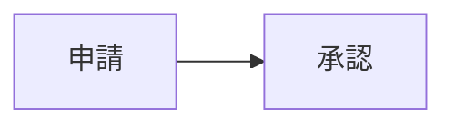

# 運用手順

[English](user-guide.md) · **日本語**

この拡張 (Markdown Formal PDF / Word) で、Markdown から正式文書の PDF と Word (.docx) を作るための手順です。
初めて使う方を読者としています。

---

## 0. この文書の要点

- **元の Markdown は変更されません。** 変換は読み取るだけです。
- **PDF が正本、Word は編集用の下書きです。** PDF と Word は別のしくみで作るため、見え方が少し違います。違いは各節の表に書いています。
- **保護には限界があります。** 編集制限は「うっかり編集」を防ぐだけで、電子署名は改ざんを「見つける」しくみです。改ざんを「防ぐ」ことはできません。
- **閲覧する環境を指定できない場合、確実に働く改ざんの確認は SHA-256 (ファイルの指紋) の台帳照合だけです。**

### やりたいこと別の早見表

| やりたいこと | 読む節 |
|---|---|
| 拡張を入れたい | [1. 導入](#1-導入) |
| 表紙・文書管理番号・社外秘のスタンプを付けたい | [2-1. 表紙の情報を書く](#2-1-表紙の情報を書く) |
| どこで改ページされるか知りたい・白紙のページが出る | [2-2. 改ページの決まり方](#2-2-改ページの決まり方) |
| 行間を変えたい | [2-3. 行間](#2-3-行間) |
| 表の列の幅・ページをまたぐ表の扱いを知りたい | [2-4. 表](#2-4-表) |
| Mermaid の図の大きさを変えたい | [2-5. 図 (Mermaid)](#2-5-図-mermaid) |
| draw.io の図や写真を入れたい | [2-6. 画像](#2-6-画像) |
| 手で書いた目次を PDF・Word に出したくない | [2-7. 目次](#2-7-目次) |
| 変換したい | [3. 変換する](#3-変換する) |
| PDF を編集できないようにしたい・署名したい | [4. 保護の設定](#4-保護の設定) |
| 改ざんされていないか確かめたい | [5. 改ざん検知の運用](#5-改ざん検知の運用-最重要) |
| うまくいかない | [7. 困ったとき](#7-困ったとき) |

---

## 1. 導入

### 1-1. 前提の確認

PDF を作るには、ブラウザの Google Chrome か Microsoft Edge のどちらかが必要です。
Mermaid の図と社外秘のスタンプを描くのにも使うため、Word だけを作る場合も必要です。

よくある場所に入っていれば自動で見つけます。見つからない場合だけ、
設定 `markdownFormal.browser.executablePath` にブラウザの実行ファイルの場所を書いてください。

| OS | よくある場所 |
|---|---|
| macOS | `/Applications/Google Chrome.app/Contents/MacOS/Google Chrome` |
| Windows | `C:\Program Files\Google\Chrome\Application\chrome.exe` |
| Linux | `/usr/bin/google-chrome` |

---

### 1-2. 拡張のインストール

受け取った VSIX (拡張のファイル) を、ターミナルでインストールします。
ファイル名の版数 (`0.3.7` の部分) は、受け取ったファイルに合わせて書き換えてください。

```bash
code --install-extension markdown-formal-pdf-0.3.7.vsix --force
```

インストールされたかを確認します。

```bash
code --list-extensions --show-versions | grep markdown-formal-pdf
```

→ `kazunito.markdown-formal-pdf@0.3.7` のように版数付きで表示されれば成功です。

最後に、VS Code のコマンドパレット (`Ctrl/Cmd + Shift + P`) で `Developer: Reload Window` を実行します。
実行するまでは、古い版のまま動きます。

> **注意**: VSIX で配った拡張は自動では更新されません。新しい版を受け取ったら、同じ手順で入れ直してください。

---

## 2. 文書の作り方

### 2-1. 表紙の情報を書く

Markdown の先頭に、`---` で囲んだ表紙の情報 (front matter と呼びます) を書きます。表紙はここから自動で作られます。

```markdown
---
title: システム運用手順書
subtitle: 第 1.0 版
author: インフラ運用チーム
date: 2026-08-08
docno: DOC-INF-2026-0142
classification: 社外秘
---
```

| 項目 | 表紙での位置 | 省略 |
|---|---|---|
| `docno` | 左上 (文書管理番号) | 可 |
| `classification` | 右上 (赤いスタンプ) | 可 |
| `title` | 中央 | 可 |
| `subtitle` | 中央 | 可 |
| `author` / `date` | 中央下 | 可 |

- `title` `docno` `classification` のどれも書かないと、表紙のページは作られず、1 ページ目が目次になります (PDF・Word 共通)。
- 表紙と目次にはページ番号を付けず、本文の最初のページを 1 ページ目にします。

---

### 2-2. 改ページの決まり方

改ページは自動で決まります。Markdown に改ページの指定を書く必要はありません。

| 決まり | PDF | Word |
|---|---|---|
| 表紙と目次は、それぞれ 1 ページを使う | ○ | ○ |
| `#` と `##` (見出し 1・2) の前で改ページする。設定 `heading.pageBreakLevel` で変えられる (`1` なら `#` だけ、`0` なら改ページしない) | ○ | ○ |
| 本文の最初の見出しの前では改ページしない (白紙のページを作らない) | ○ | ○ |
| 見出しだけがページの最後に残らないよう、次の内容と同じページへ送る | ○ | ○ |
| 見出しの直後の Mermaid の図は、見出しと同じページに置く | ○ | ○ |
| 図と画像はページの途中で切らず、入りきらなければ次のページへ送る | ○ | ○ |
| 表は行の途中で切らない。表全体は送らず、ページの境目で分ける ([2-4](#2-4-表)) | ○ | ○ |
| コードブロック・引用は、ページの境目で分ける | ○ | ○ |
| 分けるとき、境目に 1 行だけ取り残さない (2 行以上にする) | ○ | ○ |
| 章の導入文と最初の小さな表 (6 行以下) を同じページに置く | ○ | × |
| 章の直前の表のあとに、白紙のページを作らない | — | ○ |

- PDF の「—」は、もともと起きないので対策が要らないという意味です。
- 見出しと図の組が 1 ページに収まらないほど大きい場合、図は自動で縮みます ([2-5](#2-5-図-mermaid))。

---

### 2-3. 行間

本文の行間は、設定 `font.lineHeight` (文字の大きさに対する倍率。既定 `1.75`) で決まります。
文字の大きさは `font.size` (既定 `10.5pt`) です。

| 部分 | 文字の大きさ | 行の高さ |
|---|---|---|
| 本文・箇条書き・引用 | `font.size` | 文字の大きさ × `font.lineHeight` |
| 見出し | 見出しごとに決まった大きさ | 文字の大きさ × 1.35 |
| 表・コードブロック | 9pt | 9pt × `font.lineHeight` |

PDF と Word は同じ行の高さになります。画像を含む行だけは、画像が切れないよう Word が高さを自動で決めます。

---

### 2-4. 表

Markdown の表をそのまま使えます。列の幅などの指定は要りません。

| 決まり | PDF | Word |
|---|---|---|
| 列の幅は中身から自動で決め、説明の長い列を広くする | ○ | ○ |
| 見出しを含むすべてのセルが 8 文字以下の列 (番号・章・地域など) は改行しない | ○ | ○ |
| 長い URL や識別子は、必要なときだけ途中で折り返す | ○ | ○ |
| 表は行の途中で切らない。入りきらない行は行ごと次のページへ移る | ○ | ○ |
| ページをまたいだ表の続きのページに、見出しの行をもう一度出す | × | ○ |

- 「8 文字以下の列は改行しない」は、「番号」が「番 / 号」、「第 10 章」が「第 / 10 / 章」のように割れるのを防ぐためのものです。長い文が 1 つでもある列は、ほかの列を狭めないよう今までどおり改行します。
- 列が多すぎて右にはみ出す表は、`<div class="fit">` と `</div>` で囲むと 6 割の大きさに縮みます (PDF のみ)。

```markdown
<div class="fit">

| 列1 | 列2 | 列3 | 列4 | 列5 | 列6 |
|---|---|---|---|---|---|
| … | … | … | … | … | … |

</div>
```

→ `<div class="fit">` の次の行と `</div>` の前の行は、空けておいてください。空けないと表として読まれません。

---

### 2-5. 図 (Mermaid)

```` ```mermaid ```` のコードブロックは、図として描かれます。PDF には拡大しても粗くならない形式 (SVG) で、Word には画像 (PNG) で入ります。

````markdown

````

図の大きさは次の順で決まります。

1. 幅は本文の幅に合わせて広げる (設定 `mermaid.maxWidth` で本文の幅の何 % までかを指定。既定 `100`)
2. ただし、要素の少ない図が大きくなりすぎないよう、図の文字が表の文字 (9pt) より大きくならないところで止める
3. 高さが設定 `mermaid.maxHeightMm` (既定 `120`mm) を超えるときは、縮めて収める。1 ページに収まらないときは、ページに入る高さまで縮める

PDF と Word で同じ大きさになります。

- 縦に長い図が小さくなりすぎる場合は、用紙を大きく (`page.format` を `A3`) するか、横向き (`page.orientation` を `landscape`) にしてください。PDF と Word の両方に効きます。
- 記法に誤りがあるときは、図にせずコードブロックのまま出し、変換後の通知に理由が出ます。
- 図にしたくないときは、設定 `mermaid.enabled` をオフにします。
- 図の色は設定 `mermaid.theme` で変えられます。白黒で印刷するなら既定の `neutral` が安全です。

---

### 2-6. 画像

画像は、Markdown の書き方 `` で入れます。場所は、元の Markdown があるフォルダからの位置で書きます。

```markdown

```

→ Markdown と同じフォルダの中の `図解` フォルダにある `01-全体図.drawio.png` を入れます。日本語や空白を含むファイル名も使えます。

使える形式は PDF と Word で違います。

| 形式 (拡張子) | PDF | Word |
|---|---|---|
| PNG (`.png`) | ○ | ○ |
| JPEG (`.jpg` / `.jpeg`) | ○ | ○ |
| GIF (`.gif`) | ○ | ○ (動く GIF は最初の 1 コマだけ) |
| SVG (`.svg`) | ○ | × |
| WebP・BMP・TIFF・HEIC など | × | × |
| Web 上の画像 (`https://`〜) | × | × |

- **draw.io の図は PNG で書き出すのが確実です。** SVG で書き出すと Word に入りません。
- 画像は元の大きさより大きくせず、本文の幅と 1 ページに収まる高さまで縮めます。画像だけの行は中央に置きます。
- 形式は拡張子で見分けます。拡張子と中身が違う (中身は JPEG なのに `.png` が付いている など) と、Word で大きさが崩れることがあります。
- 入れられなかった画像は、`説明` の文字が代わりに出て、変換後の通知にファイル名と理由が出ます。

---

### 2-7. 目次

目次は、見出しから自動で作られます。目次に載せる見出しの深さは、設定 `toc.depth` (既定 `3` = `###` まで) で決めます。

| 決まり | PDF | Word |
|---|---|---|
| 見出しの一覧と、各見出しへのリンクを入れる | ○ | ○ |
| ページ番号を入れる | ○ (自動) | 手で更新 (下記) |

**Word のページ番号**: Word では目次のページ番号を空欄で出します。
Word で `Ctrl + A` (Mac は `Cmd + A`) で全体を選び、`F9` を押すとページ番号が入ります。
保存すれば、次に開いたときもページ番号は残ります。Word を開いたときに更新の確認は出ません。

**目次の題名**: 既定の題名は英語の `Contents` です。日本語の文書では、設定 `toc.title` に `目次` を書いてください。

**手で書いた目次を出さない**: GitHub や VS Code のプレビューで読むために本文に目次を書いた場合は、
前後を `<!-- toc -->` と `<!-- /toc -->` で囲みます。囲んだ部分は PDF・Word には出ないので、目次が二重になりません。
目印は Markdown の画面には表示されません。

```markdown
<!-- toc -->
## 目次
1. [はじめに](#第1章-はじめに)
2. [手順](#第2章-手順)
<!-- /toc -->
```

- 閉じる目印は `<!-- tocstop -->` でもかまいません。VS Code の目次作成拡張 (Markdown All in One など) が自動で付ける書き方です。
- 大文字・小文字と、目印の前後の空白は問いません。目印は、それぞれ 1 行に単独で書いてください。
- 閉じる目印を書き忘れると、何も消さずにそのまま出します (本文を丸ごと消さないため)。
- コードブロック (```〜```) の中の目印は、書き方の例とみなして無視します。

---

## 3. 変換する

Markdown を開いた状態で、次のどれかで変換します。

- 編集画面の右上にあるボタン (PDF と Word の両方に変換)
- 編集画面・タブ・エクスプローラーで右クリック → `Markdown Formal で変換`
- コマンドパレット (`Ctrl/Cmd + Shift + P`) で次のコマンドを実行

| コマンド | 出力 |
|---|---|
| `Markdown Formal: PDF に変換` | `.pdf` と `.pdf.sha256` |
| `Markdown Formal: Word (docx) に変換` | `.docx` と `.docx.sha256` |
| `Markdown Formal: PDF と Word の両方に変換` | 上記すべて |

- 出力先は、元の Markdown と同じフォルダです (設定 `outputDirectory` で変えられます)。
- `.sha256` は改ざんの確認に使うファイルの指紋です ([5](#5-改ざん検知の運用-最重要))。

> **コマンド名は VS Code の表示言語で変わります。** 上は日本語表示のときの名前です。
> 英語表示では `Markdown Formal: Convert to PDF` / `Convert to Word (docx)` / `Convert to both PDF and Word` です。

> **文書に載る文字は表示言語で変わりません。** 目次の題名 (`toc.title`、既定 `Contents`) と
> 署名の理由 (`signing.reason`、既定 `Approved as an official document`) は、日本語の文書では設定で書き換えてください。

---

## 4. 保護の設定

### 4-1. 方式を選ぶ

設定 `markdownFormal.protection.mode` で選びます。**編集制限と電子署名は同時に使えません。**

| 値 | 内容 | 使いどころ |
|---|---|---|
| `none` | 保護しない | 下書き・回覧前 |
| `restrict` | 編集制限 (権限パスワード) | **証明書がまだ無い段階の既定** |
| `sign` | 電子署名 | 証明書が用意でき、閲覧環境も指定できる場合 |

---

### 4-2. 編集制限を使う場合

コマンドパレットで `Markdown Formal: オーナーパスワードを保存 (SecretStorage)` を実行し、パスワードを入力します。
パスワードは VS Code の安全な保管場所 (SecretStorage) に保存され、設定ファイル (`settings.json`) には書かれません。

編集制限が掛かったかを確認します。`手順書.pdf` は確認する PDF のファイル名に書き換えてください。

```bash
pdfinfo 手順書.pdf | grep -i encrypted
```

→ `change:no` が含まれていれば、編集が制限されています。

> **限界**: 編集制限は、閲覧ソフトが守ってくれることを前提にした「お願い」です。
> 無視する閲覧ソフトもあるため、うっかり編集の防止にはなりますが、改ざんの防止にはなりません。

---

### 4-3. 電子署名を使う場合

**先に証明書の準備が必要です。**

1. 社内の認証局 (CA) で、文書署名用の証明書 (`.p12` / `.pfx`) を発行してもらう
2. 証明書を**リポジトリの外**の安全な場所に置く (例: `~/.certs/doc-signing.p12`)
3. 設定 `markdownFormal.signing.certificatePath` に、証明書の場所をフルパスで書く
4. コマンドパレットで `Markdown Formal: 証明書パスフレーズを保存 (SecretStorage)` を実行する
5. 設定 `markdownFormal.protection.mode` を `sign` にする

署名を確認します。`手順書.pdf` は確認する PDF のファイル名に書き換えてください。

```bash
pdfsig 手順書.pdf
```

→ `Signature is Valid.` と表示されれば、署名のあとに変更されていません。

> **限界**: 署名は改ざんを「防ぐ」のではなく「見つける」しくみです。編集そのものはできてしまい、
> 編集されると署名が無効になることで改ざんが分かります。

---

## 5. 改ざん検知の運用 (最重要)

### 5-1. 閲覧環境による違い

**署名を確かめるのは閲覧ソフトです。** そのため、閲覧ソフトによっては改ざんに気づけません。

| 閲覧環境 | 署名の確認 |
|---|---|
| Adobe Acrobat Reader | 自動で確かめて表示する (**推奨**) |
| Microsoft Edge | 機能はあるが**既定では無効**。`PDFSecureMode` ポリシーなどで有効にする必要がある |
| Google Chrome | **確かめられない** |
| コマンド | `pdfsig` で確かめられる |

さらに Chrome には、**署名済みの PDF を「PDF に保存」で印刷すると、警告なしに署名が消える**不具合があります。
署名済みの文書を Chrome で保存し直さないでください。

---

### 5-2. 閲覧環境を指定できない場合

**SHA-256 (ファイルの指紋) の台帳照合を運用の中心にします。** これだけは閲覧ソフトに左右されません。
ファイルが 1 文字でも変わると、指紋の値はまったく別のものになります。

**発行するとき**: 変換と同時に作られる `.sha256` の中身を、文書管理台帳に書き写します。

```bash
cat 手順書.pdf.sha256
```

→ `efe17a83…3ba7a  手順書.pdf` のように、指紋の値とファイル名が表示されます。この 1 行を台帳に書き写します。

**受け取ったとき**: 受け取った側が、手元のファイルの指紋を照合します (Mac・Linux)。

```bash
shasum -a 256 -c 手順書.pdf.sha256
```

→ `手順書.pdf: OK` と表示されれば、改ざんされていません。

台帳の値と目で見比べる場合は、指紋だけを表示します。

```bash
shasum -a 256 手順書.pdf
```

→ 表示された値が台帳の値と一致すれば、改ざんされていません。

Windows の場合は PowerShell で指紋を表示します。

```powershell
Get-FileHash -Algorithm SHA256 .\手順書.pdf
```

→ `Hash` の欄の値を台帳と見比べます (大文字・小文字の違いは問いません)。

表紙の**文書管理番号** (`docno`) が、台帳と文書を結び付ける鍵になります。

---

### 5-3. 拡張から確かめる

コマンドパレットで `Markdown Formal: PDF を検証 (ハッシュ / 保護状態)` を実行し、確かめる PDF を選びます。
ページ数・編集制限の有無・署名の有無・SHA-256 の値が、出力パネルに表示されます。

---

## 6. 段階移行の計画

| 時期 | 保護 | 検知 |
|---|---|---|
| 現在 (証明書なし) | 編集制限で、うっかり編集を防ぐ | SHA-256 の台帳照合 |
| 証明書を入手したあと | 電子署名に切り替え (編集制限とは同時に使えない) | 署名の確認 + SHA-256 |

証明書が用意できたら、`protection.mode` を `sign` に変えるだけで移行できます。

---

## 7. 困ったとき

| 症状 | 対処 | 詳しく |
|---|---|---|
| `Chrome または Edge が見つかりませんでした` | どちらかを入れるか、`browser.executablePath` を設定する | [1-1](#1-1-前提の確認) |
| 直したはずの動きにならない | `Developer: Reload Window` を実行してから変換し直す | [1-2](#1-2-拡張のインストール) |
| 目次のページ番号が出ない (Word) | Word で `Ctrl + A` → `F9` を押して保存する | [2-7](#2-7-目次) |
| Word を開くたびに目次の更新を確認され、保存しても繰り返す | 0.3.6 以前の不具合です。0.3.7 以降で変換し直す | [2-7](#2-7-目次) |
| 手で書いた目次が PDF・Word に出る | `<!-- toc -->` と `<!-- /toc -->` で囲む。閉じる目印の書き忘れに注意 | [2-7](#2-7-目次) |
| Word で章の前に白紙のページが出る | 0.3.6 以前の不具合です。0.3.7 以降で変換し直す | [2-2](#2-2-改ページの決まり方) |
| ページの下半分が大きく空く | 0.2.0 以前の不具合です。0.2.1 以降に更新する | [2-2](#2-2-改ページの決まり方) |
| 表が右にはみ出す | 列を減らすか、`<div class="fit">` で囲む (PDF のみ) | [2-4](#2-4-表) |
| 「番号」「第 10 章」などが途中で改行される | 0.3.6 以前の動きです。0.3.7 以降で変換し直す。9 文字以上のセルがある列は改行される | [2-4](#2-4-表) |
| Word で表の 1 行がページの境目で上下に分かれる | 0.3.6 以前の不具合です。0.3.7 以降で変換し直す | [2-4](#2-4-表) |
| 表の続きのページに見出しの行が出ない (PDF) | 今の制限です。Word では出ます | [2-4](#2-4-表) |
| Mermaid が図にならずコードのまま出る | 変換後の通知に理由が出る。記法の誤りか、Chrome / Edge が見つからない | [2-5](#2-5-図-mermaid) |
| 縦に長い Mermaid の図が小さくなる | 用紙を `A3` にするか横向きにする | [2-5](#2-5-図-mermaid) |
| 要素の少ない Mermaid の図だけ大きく見える | 0.3.6 以前の動きです。0.3.7 以降で変換し直す | [2-5](#2-5-図-mermaid) |
| 画像が出ず、説明の文字だけが出る | 通知のファイル名と理由を見る。場所が元の Markdown からの位置で正しいか、形式が使えるか (Word は SVG 不可) を確かめる | [2-6](#2-6-画像) |
| Word の行間が PDF より広い | 0.3.6 以前の動きです。0.3.7 以降で変換し直す | [2-3](#2-3-行間) |
| Windows / Linux で書体が違う | 書体の設定に、各 OS の書体を順に並べる (既定はヒラギノ → 游 → Noto) | — |
| 署名が「未検証」と表示される | 自分で作った証明書のため。社内の認証局の証明書を各 PC に配る | [4-3](#4-3-電子署名を使う場合) |
| 署名と編集制限を両方掛けたい | **できません。** 必要なら別のファイルとして出し分ける | [4-1](#4-1-方式を選ぶ) |
