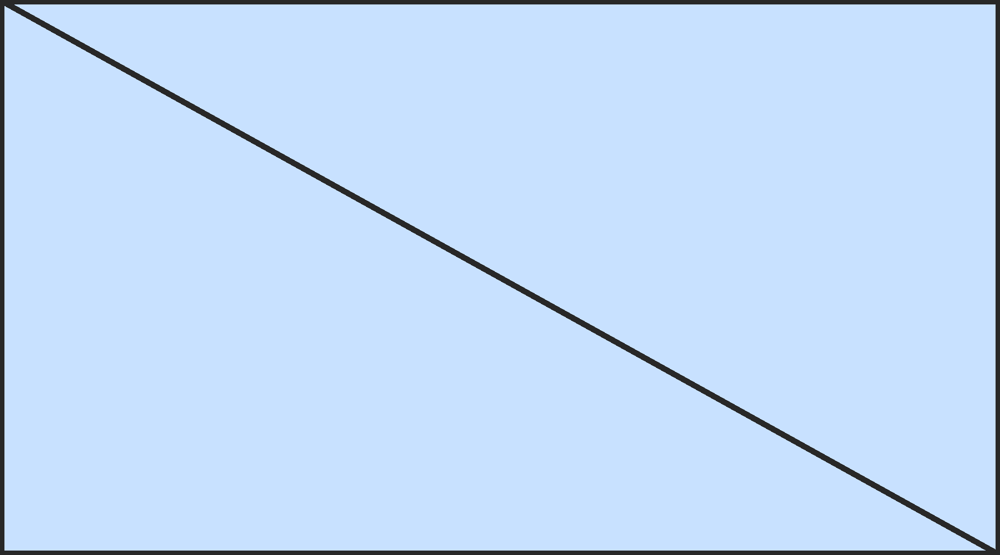
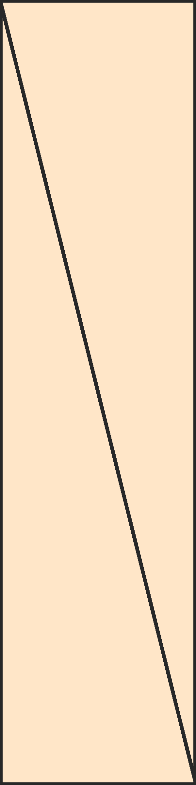
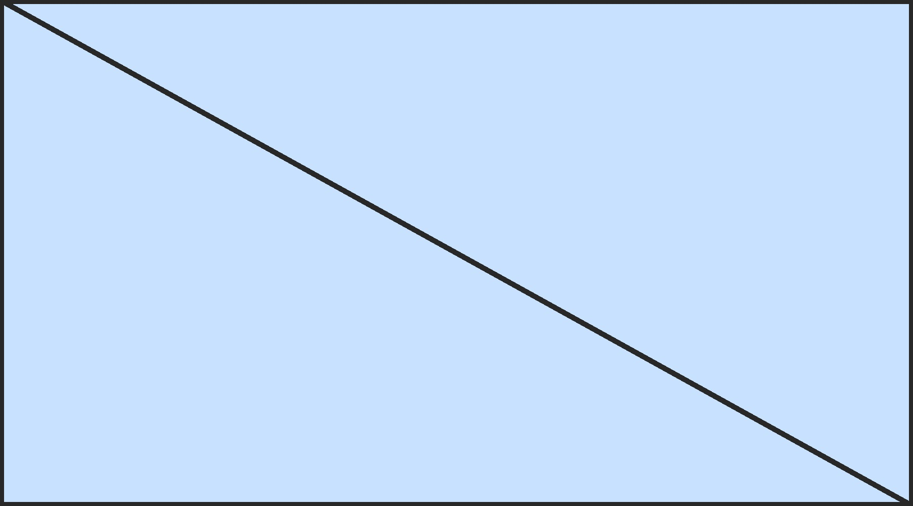

# 1. 画像の確認

## 1.1 横長の PNG (本文幅に縮小)

## 1.2 縦長の PNG (図の高さの上限に縮小)

## 1.3 小さい PNG (拡大しない)

## 1.4 日本語と空白を含むパス

## 1.5 JPEG

## 1.6 表の中の画像

| 項目 | 画像 |
|---|---|
| 小さい |  |

## 1.7 文中の画像

前の文  後の文。

## 1.8 存在しない画像 (説明文を文字で残し、通知する)

